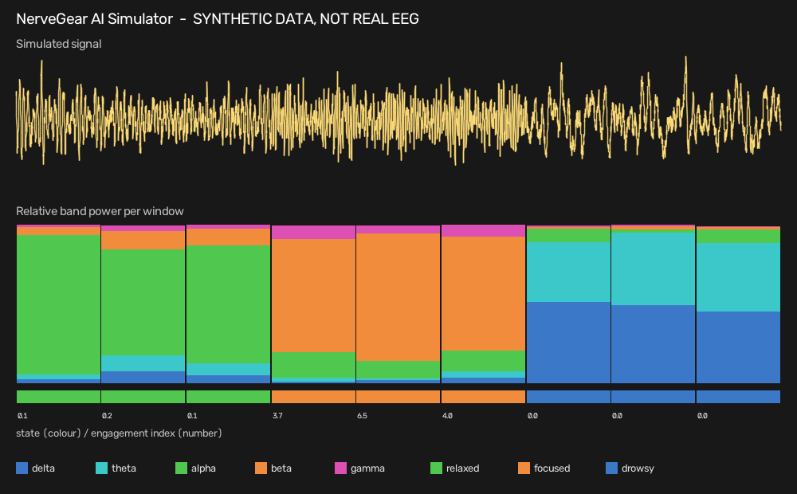

# NerveGear AI Simulator

A **software-only simulation** of a basic EEG analysis pipeline: it generates *synthetic* brain-wave-like signals, measures power in the standard frequency bands with an FFT, computes an engagement ratio, labels the simulated state, and draws a dashboard.

> **Honest scope.**
> - All signals are **synthetic** (sums of sine waves plus noise). **No real EEG, no EEG hardware, no human data.**
> - It is **not** a medical or diagnostic tool and says nothing about real brains.
> - It is **not** a brain-computer interface and not related to any commercial product.
> - "100 % of windows correct" in the demo only shows the rules agree with the generator that made the data. It is **not** an accuracy claim.
>
> **AI assistance.** Written with AI assistance (Claude), reviewed and published by the repository owner. See [HOW_IT_WORKS.md](HOW_IT_WORKS.md).



## What it does

| Step | File | What |
|---|---|---|
| Generate | `nervegear/signal.py` | 256 Hz signal for three scenarios: relaxed (strong alpha), focused (strong beta), drowsy (strong delta/theta). Seeded, so reproducible |
| Analyse | `nervegear/analysis.py` | Hann-windowed FFT -> power in delta/theta/alpha/beta/gamma; engagement index = beta / (alpha + theta); rule-based state label |
| Run | `nervegear/simulate.py` | 2-second windows over a scenario sequence, prints a table, writes `windows.csv` and `dashboard.png` |
| Draw | `nervegear/dashboard.py` | PNG via OpenCV (no matplotlib) |

## Run

```bash
pip install -r requirements.txt     # numpy (+ opencv for the PNG)
python -m unittest                  # 12 tests
python -m nervegear.simulate --scenarios relaxed focused drowsy --seed 1 --out out
```

## Verified

- ✅ 12 unit tests: reproducibility, a pure 10 Hz sine lands in alpha, a 20 Hz sine in beta, relative powers sum to 1, engagement ordering, each scenario recognised for 10 random seeds, dashboard file is written.
- ✅ Demo run shown above (the image is that actual output).
- ⛔ Not validated on any real EEG recording.

## Possible next steps (not done)

Add noise levels/artifacts (blinks, 50 Hz mains), load a public EEG dataset (e.g. from PhysioNet) and see where the simple rules fail.

## License

MIT
